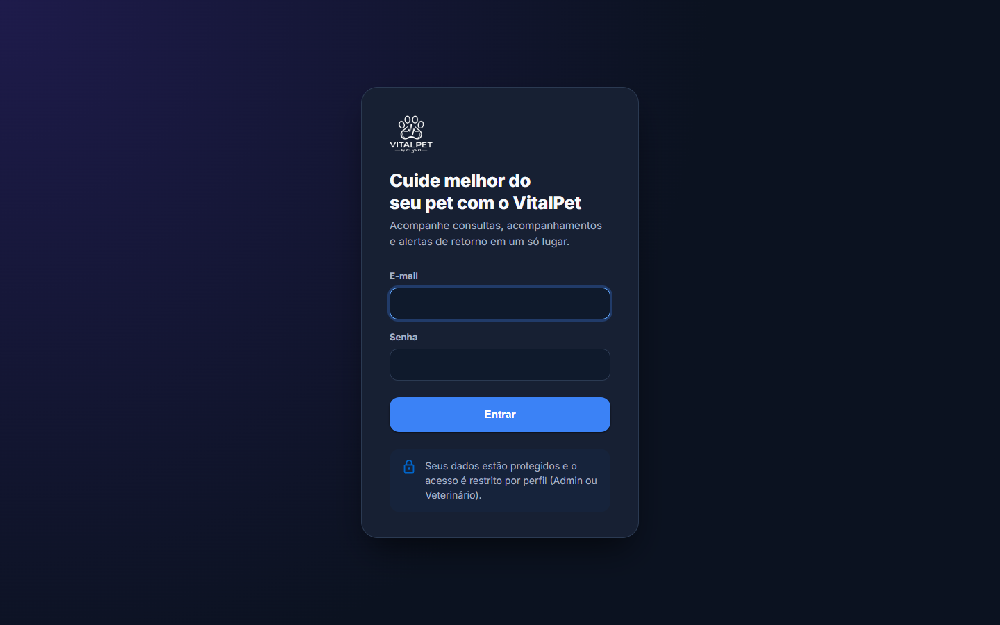
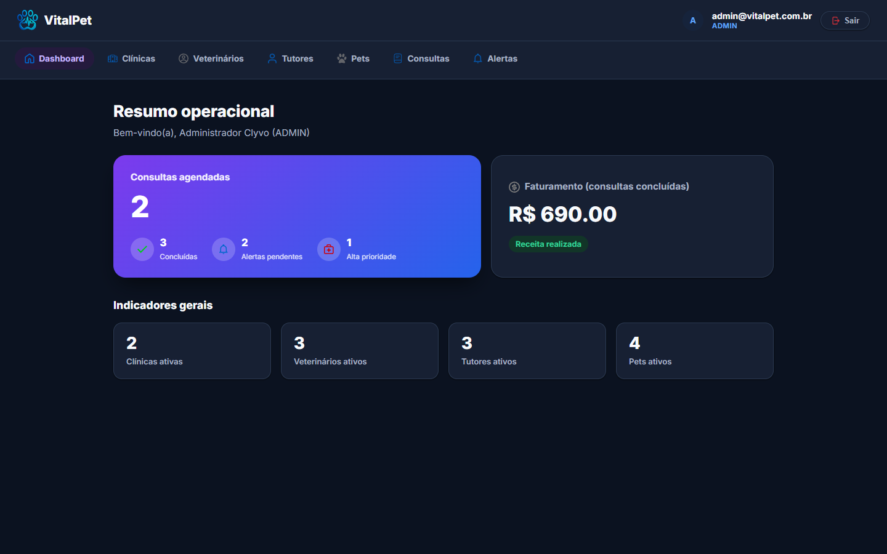
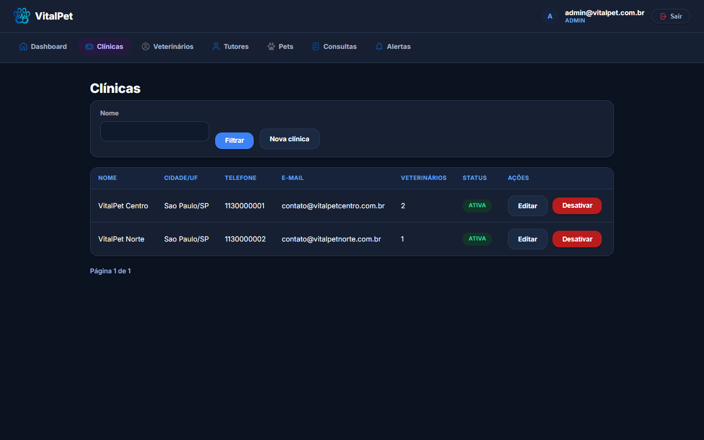
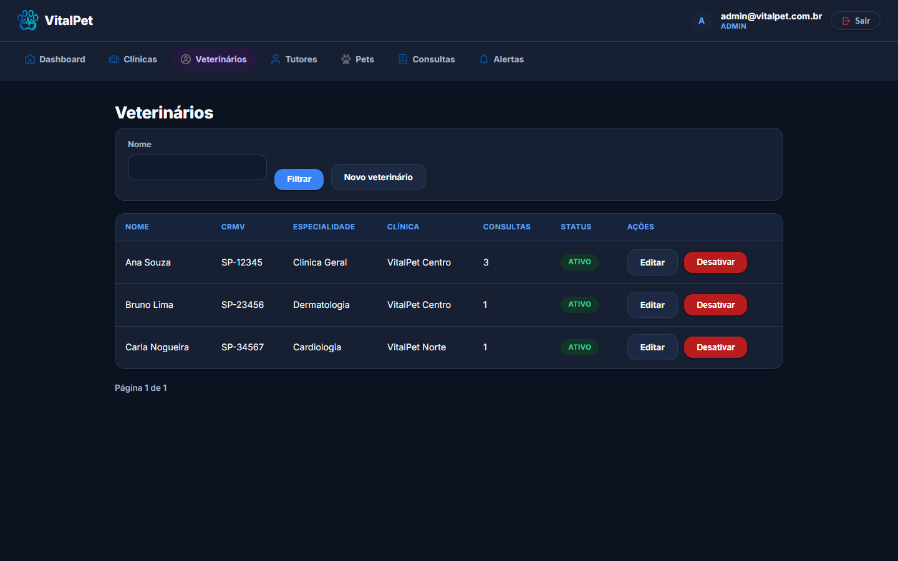
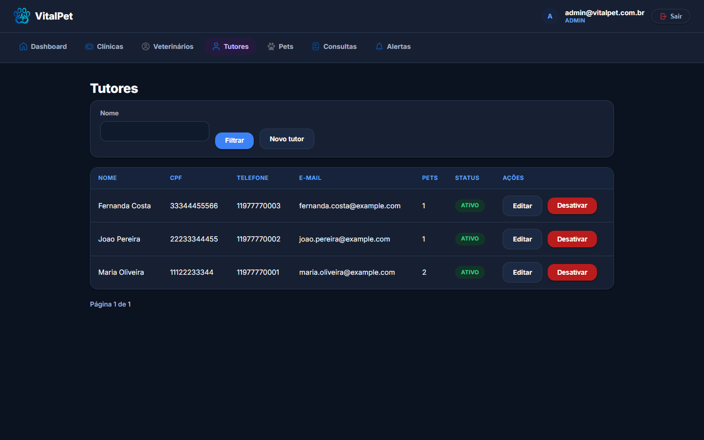
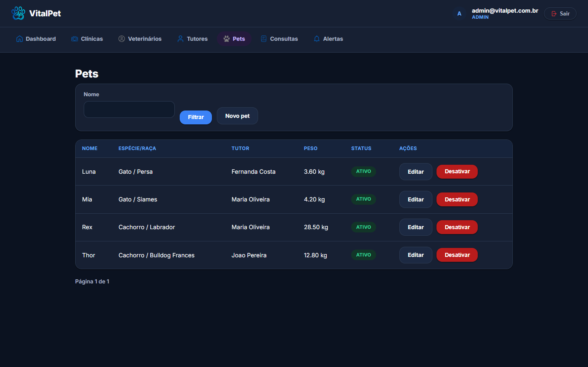
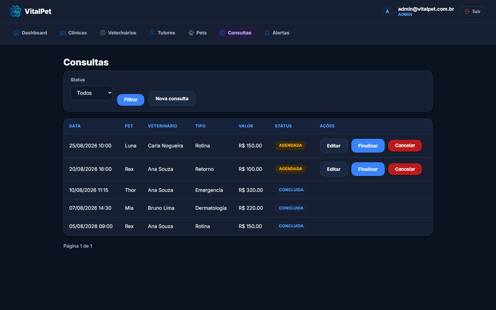
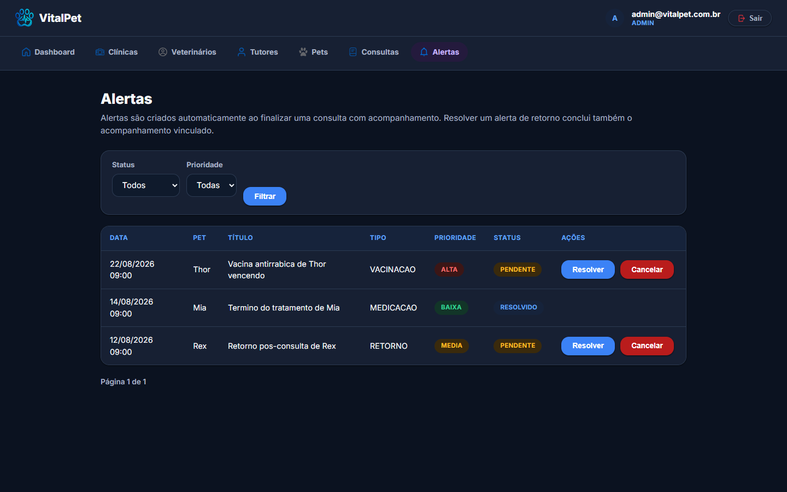
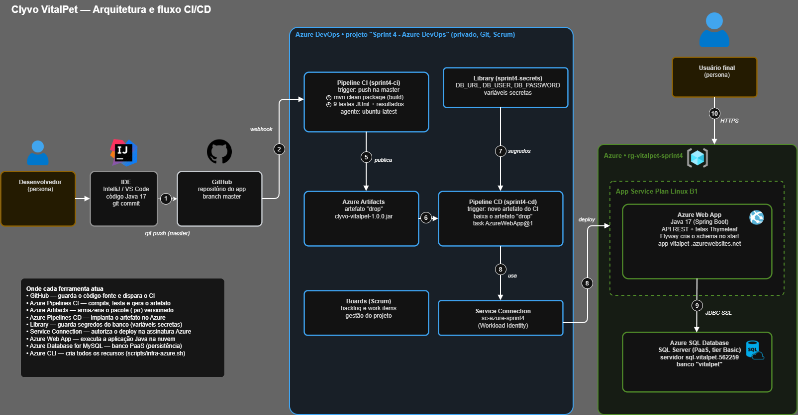

# Clyvo VitalPet — Sprint 4 (Java Advanced)

Aplicação web de gestão veterinária em **Java 17 + Spring Boot**, publicada online no **Azure Web App** com banco **Azure SQL Database**. O VitalPet acompanha o pet **depois** da consulta: ao finalizar um atendimento, o sistema cria automaticamente um acompanhamento clínico e um alerta de retorno.

## Links da entrega

| Item | Link |
|---|---|
| Repositório (Java Advanced) | https://github.com/Tidlle/Sprint4-Java |
| Vídeo de apresentação (Java Advanced) | https://www.youtube.com/watch?v=sEJ2-2YzSPo |
| Aplicação online | https://app-vitalpet-rm562259.azurewebsites.net/web/login |
| Swagger (API REST) | https://app-vitalpet-rm562259.azurewebsites.net/swagger-ui/index.html |
| Repositório e pipelines (DevOps) | https://github.com/Tidlle/Sprint4-DevOps |
| Projeto no Azure DevOps | https://dev.azure.com/RM5622590186/Sprint%204%20%E2%80%93%20Azure%20DevOps |
| Vídeo do CI/CD (DevOps) | https://www.youtube.com/watch?v=dMQ2hvaYnQg |

### Como testar a aplicação online

Acesse o link da aplicação e entre com um dos usuários de demonstração (senha dos dois: `VitalPet@123`):

| Perfil | E-mail |
|---|---|
| ADMIN | `admin@vitalpet.com.br` |
| VETERINARIO | `ana.souza@vitalpet.com.br` |

> O Web App roda em um plano que pode "dormir" por inatividade: a primeira requisição pode levar de 1 a 2 minutos.

## Integrantes

| Integrante | RM | Turma |
|---|---|---|
| João Victor Alcantara | RM562707 | 2TDSR |
| Phillipo Barbosa | RM565399 | 2TDSA |
| Eduardo Martins | RM562259 | 2TDSR |
| Leonardo Aragaki Rodrigues | RM562944 | 2TDSR |

## Narrativa da solução

**O problema.** A clínica veterinária cuida bem do pet durante a consulta, mas perde o fio depois dela. O tutor sai do consultório, esquece o retorno e o tratamento, e a clínica não tem como acompanhar. O resultado é perda de continuidade do cuidado e retornos que não acontecem.

**A solução.** O VitalPet fecha o ciclo do cuidado com uma regra de negócio simples e automática:

1. O veterinário finaliza a consulta informando diagnóstico, tratamento e a descrição do acompanhamento.
2. O sistema marca a consulta como `CONCLUIDA`, cria um `Acompanhamento` vinculado e cria um `Alerta` de retorno para **7 dias depois**.
3. Quando o alerta é resolvido, o acompanhamento é concluído junto.

**Originalidade.** A maioria dos sistemas de clínica só cadastra a consulta. Aqui o foco é a **continuidade**: o retorno é gerado pelo sistema, sem depender de memória ou planilha. Toda a operação (clínicas, veterinários, tutores, pets, consultas, acompanhamentos e alertas) fica em uma única aplicação, com login e permissões por perfil.

**Benefícios para o negócio:** centraliza os dados, reduz a perda de informação após o atendimento, gera retornos automaticamente, isola o que cada veterinário pode ver e oferece um dashboard de indicadores.

## Decisões de design e tecnologia

| Decisão | Por quê |
|---|---|
| **Java 17 + Spring Boot 3.3** | Framework da disciplina, com ecossistema maduro para web, segurança e acesso a dados, e deploy simples em nuvem |
| **Camadas `controller` / `service` / `repository`** | As regras de negócio ficam nos services, independentes de HTTP e de banco, e podem ser testadas isoladamente |
| **DTOs e mappers** | A API nunca expõe a entidade JPA diretamente |
| **API REST (`controller`) separada das telas (`web`)** | A API fica aberta para o app mobile e o Swagger, enquanto as telas ficam protegidas por login |
| **Flyway** | O schema e a massa de dados são versionados; qualquer ambiente sobe com o mesmo banco, sem script manual |
| **Dois bancos por perfil** | H2 em memória para desenvolvimento e testes; Azure SQL na nuvem, com migrations T-SQL próprias |
| **Spring Security com 2 perfis** | `ADMIN` e `VETERINARIO`, com proteção de rotas no servidor e não só no menu |
| **Thymeleaf (renderização no servidor)** | Interface simples de manter, integrada ao Spring Security (itens de menu por perfil) |
| **Tema escuro com a identidade do app mobile** | Mesma paleta, logo e ícones do aplicativo, para manter a identidade visual entre as plataformas |
| **Exclusão lógica** | `DELETE` marca o registro como inativo, preservando o histórico clínico |

## Requisitos atendidos

| Requisito | Onde está |
|---|---|
| Frontend | Telas Thymeleaf em `src/main/resources/templates`: login, dashboard e CRUD de Clínicas, Veterinários, Tutores, Pets, Consultas e Alertas |
| Flyway | `src/main/resources/db/migration` (H2) e `db/migration-sqlserver` (Azure SQL): `V1__create_schema.sql` e `V2__seed_data.sql` |
| Spring Security (2 perfis + proteção de rotas) | `config/SecurityConfig.java`, `security/UsuarioDetailsService.java` |
| 2 fluxos completos (não-CRUD) | Finalizar consulta e Resolver alerta (seção abaixo) |
| Validações | Bean Validation nos DTOs, com mensagens de erro nos formulários e na API |
| Aplicação online | Azure Web App + Azure SQL Database (links no topo) |

## Fluxos de negócio (não-CRUD)

### 1. Finalizar consulta: gera acompanhamento e alerta

Em **Consultas → Finalizar**, ao informar diagnóstico, tratamento e a descrição do acompanhamento, o sistema:

1. marca a consulta como `CONCLUIDA`;
2. cria um `Acompanhamento` vinculado à consulta;
3. cria um `Alerta` de retorno agendado para 7 dias depois.

### 2. Resolver alerta: conclui o acompanhamento

Em **Alertas**, ao resolver um alerta vinculado a um acompanhamento ativo, o sistema conclui automaticamente esse acompanhamento (status `CONCLUIDO` e data de fim preenchida), fechando o ciclo de continuidade do cuidado.

## Perfis e permissões

| Área | ADMIN | VETERINARIO |
|---|---|---|
| Dashboard | ✅ | ✅ |
| Clínicas, Veterinários, Tutores | ✅ CRUD completo | 🚫 sem acesso (403) |
| Pets | ✅ CRUD completo | ✅ CRUD completo |
| Consultas | ✅ todas | ✅ apenas as próprias |
| Alertas | ✅ | ✅ |

Um usuário `VETERINARIO` é vinculado a um registro de `Veterinario` (coluna `veterinario_id` em `usuarios`). Esse vínculo restringe a listagem de consultas e bloqueia o acesso por link direto à consulta de outro veterinário (`WebConsultaController`).

## Capturas de tela

| Tela | Print |
|---|---|
| Login |  |
| Dashboard |  |
| Clínicas |  |
| Veterinários |  |
| Tutores |  |
| Pets |  |
| Consultas |  |
| Alertas |  |

## Integração multidisciplinar

| Disciplina | Como aparece neste projeto | Evidência |
|---|---|---|
| **Mobile Application Development** | O aplicativo mobile (React Native/Expo) consome a mesma API REST (`/api/pets`, `/api/tutores`) e compartilha com a interface web a logo, os ícones e a paleta | https://github.com/alc-joao/VitalPet-Challenge |
| **DevOps Tools & Cloud Computing** | Build, testes e deploy automáticos no Azure DevOps (CI e CD), com a aplicação no Azure Web App e o banco no Azure SQL Database | https://github.com/Tidlle/Sprint4-DevOps, `azure-pipelines-ci.yml`, `azure-pipelines-cd.yml`, `docs/arquitetura-DevOps.png` |
| **Banco de dados** | Modelo relacional de 8 tabelas versionado em scripts SQL, para H2 e para T-SQL (Azure SQL) | `src/main/resources/db/migration` e `db/migration-sqlserver` |
| **Qualidade e testes** | Testes automatizados de contexto, segurança e regra de negócio, executados a cada push pelo CI | `src/test/java`, aba **Tests** das pipelines |

### Arquitetura e fluxo CI/CD



## Stack

| Camada | Tecnologia |
|---|---|
| Linguagem / framework | Java 17, Spring Boot 3.3.5 (Web, Data JPA, Validation, Cache, Security, Thymeleaf) |
| Banco de dados | Azure SQL Database (nuvem), H2 em memória (local e testes) |
| Migrations | Flyway |
| Documentação da API | Springdoc OpenAPI / Swagger |
| Testes | JUnit 5, Spring Boot Test, Spring Security Test |
| Build | Maven (com Maven Wrapper) |
| Hospedagem | Azure App Service (Web App Linux, Java 17) |
| CI/CD | Azure DevOps (Azure Pipelines em YAML) |

## Como executar localmente

Não é necessário ter o Maven instalado.

```bash
./mvnw spring-boot:run
```

No Windows (PowerShell):

```powershell
.\mvnw.cmd spring-boot:run
```

A aplicação sobe em `http://localhost:8080/web/login` com H2 em memória; o Flyway aplica as migrations e a massa de dados (2 clínicas, 3 veterinários, 3 tutores, 4 pets, 5 consultas, acompanhamentos, alertas e os 2 usuários). Console do H2 local: `http://localhost:8080/h2-console` (JDBC URL `jdbc:h2:mem:vitalpetdb`, usuário `sa`, senha vazia).

## Testes automatizados

```bash
./mvnw test
```

| Teste | O que valida |
|---|---|
| `ClyvoVitalpetApplicationTests` | O contexto sobe com Flyway e validação do schema pelo Hibernate |
| `SecurityConfigTest` | Login obrigatório em `/web/**`, autorização por perfil e API REST aberta |
| `AlertaServiceTest` | Resolver um alerta conclui o acompanhamento vinculado |

## API REST e Swagger

A API (`/api/**`) é pública e documentada no Swagger (link no topo).

```text
POST   /api/clinicas
GET    /api/clinicas/{id}
GET    /api/clinicas?nome=vet&page=0&size=10&sortBy=nome&direction=asc
PUT    /api/clinicas/{id}
DELETE /api/clinicas/{id}          (exclusão lógica)
PATCH  /api/clinicas/{id}/ativar

POST   /api/consultas
PATCH  /api/consultas/{id}/finalizar
PATCH  /api/consultas/{id}/cancelar
PATCH  /api/alertas/{id}/resolver
GET    /api/dashboard/resumo
```

Os mesmos padrões valem para `/api/tutores`, `/api/pets`, `/api/veterinarios`, `/api/acompanhamentos` e `/api/alertas`. A collection do Postman está em `postman/Clyvo-VitalPet.postman_collection.json`.

Exemplo de `PATCH /api/consultas/{id}/finalizar`:

```json
{
  "diagnostico": "Pet saudável, sem alterações clínicas graves",
  "tratamento": "Manter alimentação balanceada e retorno em 7 dias",
  "descricaoAcompanhamento": "Acompanhar alimentação, comportamento e possíveis sinais de indisposição"
}
```

## Estrutura do repositório

```text
├── azure-pipelines-ci.yml        # Pipeline de CI
├── azure-pipelines-cd.yml        # Pipeline de CD
├── scripts/infra-azure.sh        # Criação dos recursos Azure via CLI
├── docs/                         # Diagrama de arquitetura e roteiros de vídeo
├── assets/                       # Capturas de tela e evidências
├── postman/                      # Collection do Postman
├── src/main/java/...             # Código da aplicação (controller, service, repository, web...)
├── src/main/resources/
│   ├── application.properties           # Perfil padrão (H2, local e testes)
│   ├── application-sqlserver.properties # Perfil da nuvem (Azure SQL Database)
│   ├── db/migration/                    # Migrations H2
│   ├── db/migration-sqlserver/          # Migrations T-SQL (Azure SQL)
│   ├── static/                          # CSS, logo e ícones
│   └── templates/                       # Telas Thymeleaf
└── src/test/java/...             # Testes automatizados
```
